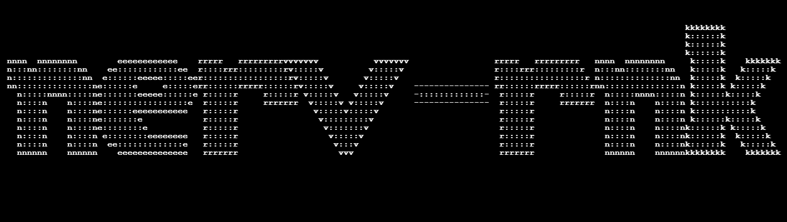

# nerv-rnk

> Personal album rating & analysis app powered by Spotify integration and user-driven curation.

---

## ✨ What is this?

**nerv-rnk** is a personal music rating and analysis tool that helps you bring structure, insight, and control to your growing album library.
It syncs with your **Spotify** account (via OAuth2) and provides an intuitive interface for rating, sorting, and exploring your music taste.

---

## 📊 Key Features

* ⭯️ **Spotify Import** — load your saved albums directly
* ⭐ **Custom Album Ratings** — both classic and ELO-based
* 🗒️ **Rich Library View** — filter by genre, mood, rating, and more
* 📊 **Analytics Dashboard** — top genres, rating activity, release insights
* 🏆 **Rankings Page** — sortable by rating, genre, year, artist
* 🎨 **Dark Theme Only** — multiple aesthetic dark UI themes

---

## 📅 Project Status

> 🚧 Currently in development

* Frontend being prototyped with **mock data**
* Core UI elements and theme system in place

---

## 🚀 Why nerv-rnk?

If you've ever:

* had too many albums and no way to sort them intuitively
* wanted to track your evolving music taste
* looked for a better way to find something to listen to based on your mood

Then **nerv-rnk** is for you.

This project aims to offer something no major streaming platform provides — actual ownership and understanding of your personal music collection.

---

## 📄 Roadmap

- [x] Initial dark theme UI
- [x] Spotify OAuth2 integration
- [x] Album rating functionality (ELO + classic)
- [x] Advanced filtering in Library (genre, mood, custom tags)
- [ ] Genre and mood tagging (user editable)
- [ ] Analytics dashboard (top genres, trends, activity)
- [ ] Mobile-friendly layout (future)
- [ ] Recommendation engine (future)

---

## 🌟 Credits

Made with passion and love for music.

---

## 🎓 License

[MIT](./LICENSE)
